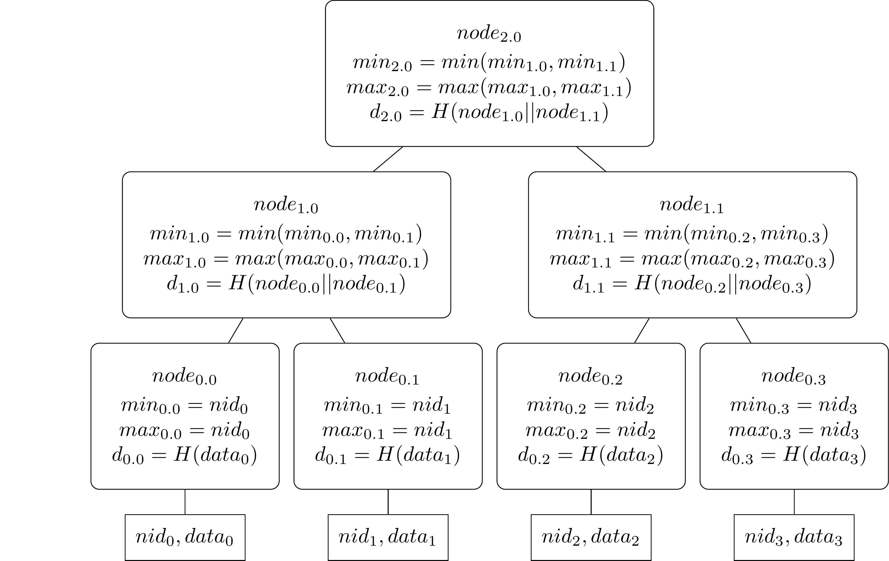

# Namespaced Merkle Tree (NMT)

[](https://pkg.go.dev/github.com/celestiaorg/nmt)
<!-- it retrieves the lint workflow status badge for the default branch i.e., main, for a different branch, specify the branch parameter in the URL() -->


A Namespaced Merkle Tree is
> [...] an ordered Merkle tree that uses a modified hash function
  so that each node in the tree includes the range of
  namespaces of the messages in all of the descendants
  of each node. The leafs in the tree are ordered by the
  namespace identifiers of the messages.
  In a namespaced Merkle tree, each non-leaf node in
  the tree contains the lowest and highest namespace
  identifiers found in all the leaf nodes that are descendants of the non-leaf node, in addition to the hash of
  the concatenation of the children of the node. This
  enables Merkle inclusion proofs to be created that prove to a verifier that all the elements of the tree for
  a specific namespace have been included in a Merkle
  inclusion proof.

The concept was first introduced by [@musalbas] in the LazyLedger [academic paper].

## Example

```go
package main

import (
    "bytes"
    "crypto/sha256"
    "fmt"

    "github.com/celestiaorg/nmt"
    "github.com/celestiaorg/nmt/namespace"
)

func main() {
    // the tree will use this namespace size (number of bytes)
    nidSize := 1
    // the leaves that will be pushed
    data := [][]byte{
      append(namespace.ID{0}, []byte("leaf_0")...),
      append(namespace.ID{0}, []byte("leaf_1")...),
      append(namespace.ID{1}, []byte("leaf_2")...),
      append(namespace.ID{1}, []byte("leaf_3")...)}
    // Init a tree with the namespace size as well as
    // the underlying hash function:
    tree := nmt.New(sha256.New(), nmt.NamespaceIDSize(nidSize))
    for _, d := range data {
      if err := tree.Push(d); err != nil {
        panic(fmt.Sprintf("unexpected error: %v", err))
      }
    }
    // compute the root
    root, err := tree.Root()
    if err != nil {
      panic(fmt.Sprintf("unexpected error: %v", err))
    }
    // the root's min/max namespace is the min and max namespace of all leaves:
    minNS := nmt.MinNamespace(root, tree.NamespaceSize())
    maxNS := nmt.MaxNamespace(root, tree.NamespaceSize())
    if bytes.Equal(minNS, namespace.ID{0}) {
      fmt.Printf("Min namespace: %x\n", minNS)
    }
    if bytes.Equal(maxNS, namespace.ID{1}) {
      fmt.Printf("Max namespace: %x\n", maxNS)
    }

    // compute proof for namespace 0:
    proof, err := tree.ProveNamespace(namespace.ID{0})
    if err != nil {
      panic("unexpected error")
    }

    // verify proof using the root and the leaves of namespace 0:
    leafs := [][]byte{
      append(namespace.ID{0}, []byte("leaf_0")...),
      append(namespace.ID{0}, []byte("leaf_1")...),
    }

    if proof.VerifyNamespace(sha256.New(), namespace.ID{0}, leafs, root) {
      fmt.Printf("Successfully verified namespace: %x\n", namespace.ID{0})
    }

    if proof.VerifyNamespace(sha256.New(), namespace.ID{2}, leafs, root) {
      panic(fmt.Sprintf("Proof for namespace %x, passed for namespace: %x\n", namespace.ID{0}, namespace.ID{2}))
    }
}
```

The above will create a Namespaced merkle tree with four leafs which looks like this:



Where `nid_0 = nid_1 = 0` and `nid_2 = nid_3 = 1` and `data_i = "leaf_i"` for `i = 0,...,3`.

## Documentation

- [NMT library guide](docs/nmt-lib.md): how to construct an NMT and generate and verify proofs using this library.
- [NMT specification](docs/spec/nmt.md): the NMT data structure and the proof generation and verification logic.
- [NMT proof format](docs/proof-format.md): the exact format of NMT proofs, their serialization, and how to verify them.

## Related

This implementation was heavily inspired by the initial implementation in [celestiaorg/lazyledger-prototype](https://github.com/celestiaorg/lazyledger-prototype).

Non-endorsed implementations of NMT exist in other languages:

Language | Repo
---------|------------------------------------------------------------------
Rust     | [Sovereign-Labs/nmt-rs](https://github.com/Sovereign-Labs/nmt-rs)

<!--- TODO references --->
[academic paper]: https://arxiv.org/abs/1905.09274
[@musalbas]: https://github.com/musalbas

## Go version

This repository follows the Go version policy for Celestia libraries. Agents and contributors should keep it when they change `go.mod` or CI.

- **`go.mod`** requires `1.N.0`, where `1.N` is the oldest Go release that is still [supported](https://go.dev/doc/devel/release#policy) (today `go 1.26.0`). Do not raise it further unless a dependency needs it, and do not add a `toolchain` line. A library's `go` directive is the minimum for every module that imports it, so a higher value forces celestia-app, celestia-core and celestia-node to upgrade Go.
- **CI** runs the tests on both supported Go releases (today 1.26 and 1.27). The job on the `go.mod` version catches code that needs a newer release.
- **Coverage** is uploaded from the newest Go release only. Go releases split code into coverage blocks differently, so mixing them moves the percentage without any change in tests.
- **Fuzzing** with `go test -fuzz`, where CI runs it, uses the newest Go release. Under Go 1.26, a fuzz target that reaches the end of its `-fuzztime` budget fails with "context deadline exceeded" ([golang/go#75804](https://go.dev/issue/75804)). nmt's CI does not run `-fuzz` today: plain `go test` runs only the seed inputs of `FuzzProveVerifyNamespace`.
- **When Go releases a new major version**, raise `go.mod` to the new oldest supported release (`1.N+1.0`) and move the CI versions up by one.

Applications (celestia-app, celestia-core, celestia-node) follow a different rule: they pin `go.mod`, CI and Docker images to one exact patch release of Go.

## Fuzzing

The fuzz targets are native Go fuzz tests (`func FuzzXxx`). `go test ./...` runs their seed inputs. To let the fuzzer search for new inputs, run:

```sh
make fuzz FUZZTIME=1m
```

The [fuzz workflow](.github/workflows/fuzz.yml) runs each target for 60 seconds on pull requests and pushes to `main`, and for 10 minutes each night. When you add a fuzz target, add it to the matrix in that workflow.

A crashing input can describe an exploitable bug. Outside pull requests, the workflow keeps the fuzz output out of the public logs and files a Linear issue with the details. Keep crash details out of public pull requests and issues.

## Contributing

PR titles must follow [conventional commits](https://www.conventionalcommits.org/en/v1.0.0/) and start the subject with `[high]`, `[medium]`, or `[low]` to indicate the review thoroughness needed. For example: `fix!: [high] correct proof verification` or `docs: [low] clarify setup instructions`. Include the same tag in the PR description and explain why you chose it.

- `[high]`: Deep review for consensus, security, or other changes with significant risk, e.g. hashing, proof generation or verification, and namespace range logic (consensus-critical for celestia-app and celestia-node).
- `[medium]`: Standard review for code changes with limited impact and well-understood behavior.
- `[low]`: Focused review for straightforward docs, tests, or tooling changes with low risk.

Choose the higher level when unsure. A small diff can still need deep review. CI checks the title format; reviewers should confirm the chosen level. The [required review policy](.github/review-policy.md) documents how the tier sets the number of independent approvals.

Markdown files must conform to [GitHub Flavored Markdown](https://github.github.com/gfm/). Markdown must be formatted with:

- [markdownlint](https://github.com/DavidAnson/markdownlint)
- [Markdown Table Prettifier](https://github.com/darkriszty/MarkdownTablePrettify-VSCodeExt)

### Protobuf

The [pb](./pb) package contains Protobuf definition files (`*.proto`) and the Go code (`*.pb.go`) generated from them. If you update a definition file, regenerate the Go code and commit both:

```sh
make proto-gen
```

This requires [protoc](https://protobuf.dev/installation/) to be installed. CI verifies that the committed generated code matches the definition files.

## Audits

Date      | Auditor                                       | Report
----------|-----------------------------------------------|--------------------------------------------------------
2023/8/18 | [Informal Systems](https://informal.systems/) | [informal-systems.pdf](docs/audit/informal-systems.pdf)
